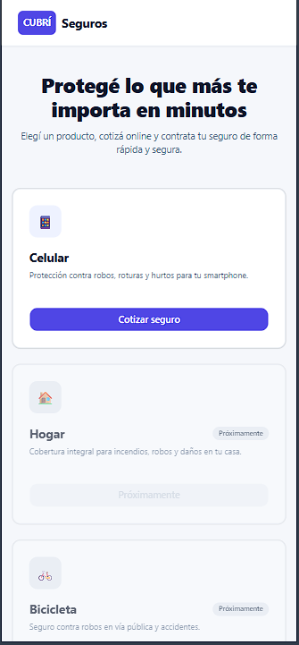
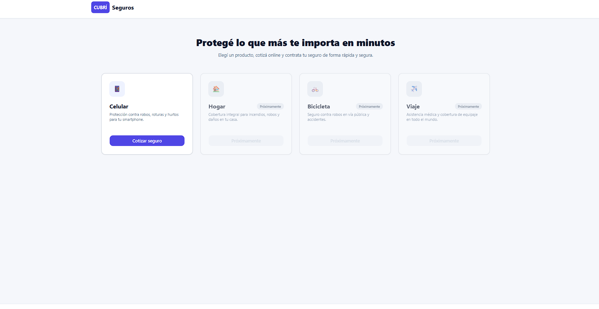

# TP5: Flujo de Contratación Digital de Seguros (Cubrí Seguros)

Materia **Diseño UXUI - 2026**.

## 👥 Integrantes
* [Taffarel Lautaro]
* [Ernst Gervasio]

---

## 🚀 Cómo correr el proyecto localmente
Dado que la aplicación carga la información de los planes a través de un archivo JSON externo utilizando `fetch`, **no se debe abrir el archivo `index.html` directamente con doble clic (`file://`)**, ya que esto generará un error de CORS en el navegador[cite: 6, 15, 16].

Para ejecutarlo de forma correcta:
1. Abre la carpeta del proyecto en **Visual Studio Code**[cite: 15, 16].
2. Levanta un servidor local utilizando la extensión **Live Server** de VS Code.
3. Ingresa a la URL local proporcionada por el servidor (ej: `http://localhost:5500`).

---

## 🛠️ Stack y Tecnologías
* **HTML5**
* **Tailwind CSS v4** (utilidades integradas mediante CDN)
* **Basecoat UI** (componentes estilizados sin necesidad de frameworks de JS)
* **JavaScript Vanilla** (Estructurado en módulos ES6)

---

## 🏛️ Decisiones de Arquitectura y Diseño
* **Gestión de Estado Centralizado:** Toda la información del flujo de contratación (equipo, plan seleccionado, datos personales y pago) vive en un único objeto de estado global (`solicitud`), asegurando que el DOM se actualice de forma reactiva a partir de él.
* **Modularización de Código:** La lógica se encuentra dividida limpiamente en archivos independientes (`app.js`, `estado.js`, `render.js`, `validaciones.js`, `cotizador.js` y `pago.js`).
* **Enfoque Responsive:** Diseño *mobile-first* optimizado para pantallas de **390px** (mobile) y adaptado mediante grillas responsivas para pantallas de **1440px** (desktop con resumen lateral fijo).

---

## 📱 Capturas de pantalla

### Vista Mobile (390 px)

### Vista Desktop (1440 px)

---

## 🌐 Enlace al sitio publicado
Puedes visualizar la aplicación funcionando en línea en el siguiente enlace:
* **URL de despliegue:** [Insertar link de Netlify / GitHub Pages aquí]